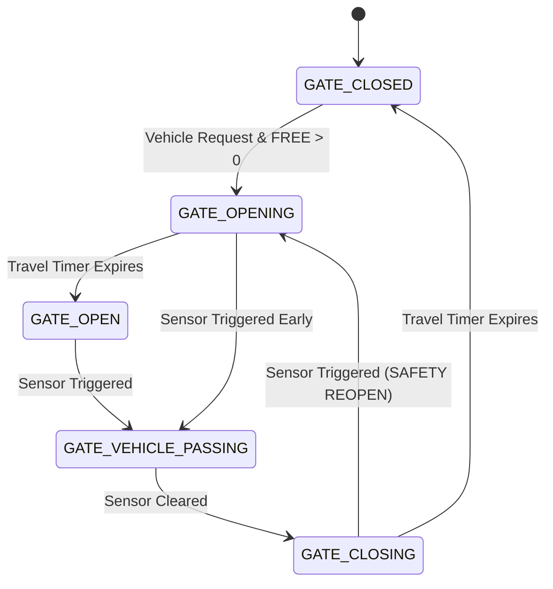

# Gate Finite State Machine (FSM)

The parking gate is controlled by a Finite State Machine implemented in `esp32/smart_parking/gate_fsm.cpp` (and mirrored in Python for simulations).

## State Diagram

## Key Mechanisms

1. **Capacity Guard:**
   In `GATE_CLOSED`, if `FREE == 0`, entry requests are DENIED. The buzzer sounds a `PARKING_FULL` pattern, and the gate does not open.

2. **Hold Open:**
   Once in `GATE_OPEN`, the gate waits for the vehicle to trigger the vehicle-present sensor (`GATE_VEHICLE_PASSING`). The gate will not close until the sensor is triggered and then cleared.

3. **Safety Re-open (Anti-Crush):**
   If the gate is in `GATE_CLOSING` and the vehicle-present sensor detects an object, it immediately aborts the close, triggers the `GATE_SAFETY` buzzer, and transitions back to `GATE_OPENING`.
